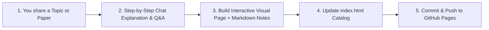

# Interactive AI Learning & Paper Breakdown Hub — Project Plan

## 1. Vision & Goal
Transform this repository into an **interactive, visual-first AI learning portal** hosted on **GitHub Pages**. Every AI concept and research paper you share will be turned into an intuitive, step-by-step visual guide designed to build deep understanding without overwhelming jargon.

---

## 2. Core Teaching Philosophy (The 5-Step Framework)
Whenever you provide an AI topic or a research paper, we will break it down using a consistent, beginner-friendly yet rigorous progression:

1. **The Big Picture & Analogy ("Why do we need this?")**
   - Plain-English explanation of the problem the concept or paper solves.
   - Real-world mental model before introducing any technical terms.
2. **Interactive Step-by-Step Visualization ("See it in action")**
   - Interactive **Next / Previous stepper animations**, sliders, and clickable diagrams.
   - Watch data flow through matrices, attention heads, neural layers, or algorithms one step at a time.
3. **Deconstructed Architecture / Mechanism ("How it works")**
   - Visual flowcharts (`Mermaid.js` & custom SVG diagrams) breaking complex systems into small, digestible blocks.
4. **Math Demystified ("Color-coded equations")**
   - Equations rendered with **KaTeX**, where every variable is color-coded and mapped directly to the visual diagram and a concrete toy-number example (e.g., $2 \times 2$ matrices instead of abstract $d$-dimensional tensors).
5. **Code & Key Takeaways ("Build & Remember")**
   - Minimal, heavily commented Python/PyTorch snippet showing how the math translates to code.
   - Quick-review summary cards and self-check questions.

---

## 3. Repository & GitHub Pages Architecture

To ensure the site deploys instantly on **GitHub Pages** with zero build-pipeline friction and maximum flexibility for custom interactive visualizations, we will use a **clean, modular HTML/JS/Markdown architecture**:

```text
my_notes/
├── index.html                  # Main GitHub Pages portal (Topic & Paper catalog, search, progress tracker)
├── PLAN.md                     # This master plan and pedagogical guide
├── README.md                   # Repository overview & live GitHub Pages link
├── assets/
│   ├── css/
│   │   └── style.css           # Unified modern dark/light UI theme, typography, and layout
│   └── js/
│       ├── core.js             # Shared navigation, theme toggle, KaTeX/Mermaid initialization
│       └── viz-helpers.js      # Reusable interactive canvas/SVG stepper & slider components
├── topics/                     # Concept-focused interactive lessons
│   └── <topic-slug>/
│       ├── index.html          # Interactive visual lesson page
│       └── notes.md            # Markdown companion notes & summary
└── papers/                     # Research paper visual breakdowns
    └── <paper-slug>/
        ├── index.html          # Interactive paper walkthrough & architecture explorer
        └── notes.md            # Structured Markdown reading notes
```

### Tech Stack for Visualizations (Zero Build Required)
- **Layout & Styling**: Modern responsive CSS (CSS Grid/Flexbox, clean dark/light mode).
- **Interactive Visuals**: Custom HTML5 Canvas / SVG + Vanilla JS steppers (and D3.js / Chart.js via CDN when helpful).
- **Diagrams**: Mermaid.js for system flowcharts and sequence diagrams.
- **Mathematics**: KaTeX for fast, crisp LaTeX equation rendering.
- **Markdown Support**: Accompanying `.md` files for every lesson so you can read them directly on GitHub or through the interactive web page.

---

## 4. Standard Templates

### A. Topic Module Template (`topics/<topic-name>/`)
1. **Header**: Topic Title, Difficulty Badge, Prerequisites, Estimated Read Time.
2. **Step 1 — Intuition**: Visual metaphor + 2-minute summary.
3. **Step 2 — Interactive Playground**: Sliders/buttons to manipulate inputs and observe outputs live.
4. **Step 3 — Step-by-Step Walkthrough**: Guided visual stages (Step 1, Step 2, Step 3...) with synchronized explanations.
5. **Step 4 — The Math With Toy Numbers**: Color-coded formula + worked numerical example.
6. **Step 5 — Minimal Code & Cheat Sheet**: 15–30 lines of clean code + summary flashcards.

### B. Research Paper Template (`papers/<paper-name>/`)
1. **Paper Metadata**: Title, Authors, Year, Link to arXiv/PDF, 1-Sentence TL;DR.
2. **The Bottleneck**: Visual comparison of what existed *before* this paper vs. what failed.
3. **The Core Insight**: The single key idea that made the paper work, illustrated visually.
4. **Interactive Architecture Walkthrough**: Click through each block of the paper's main figure (Figure 1 / Model Architecture) to see tensor shapes and operations at each stage.
5. **Key Equations Explained**: Translating the paper's notation into plain English and concrete numbers.
6. **Key Results & Limitations**: Visual summary of benchmarks, ablations, and when to use it.

---

## 5. How Our Workflow Will Operate

Whenever you give me a new **topic** or **paper**, we will follow this cycle:



1. **Submit**: You name an AI topic (e.g., *Self-Attention*, *Backpropagation*, *LoRA*, *Diffusion Models*) or provide a paper/PDF/link.
2. **Teach & Visualize**: I explain it step by step with visual diagrams and build a dedicated interactive page under `topics/` or `papers/` plus a companion `notes.md`.
3. **Catalog Update**: I register the new lesson on the main `index.html` hub so you can browse all learned topics by category.
4. **Iterate**: You ask questions or request deeper visual breakdowns on any specific step, and we refine the module until it clicks 100%.

---

## 6. Implementation Roadmap

- [x] **Phase 1: Planning & Architecture** — Define structure, pedagogy, and templates in `PLAN.md`.
- [ ] **Phase 2: GitHub Pages Portal Setup** — Create the landing page (`index.html`), shared styling (`assets/css/style.css`), and reusable stepper/visualization scripts (`assets/js/`).
- [ ] **Phase 3: First Topic / Paper Module** — Build the first interactive visual guide as soon as you share your first topic or paper.
- [ ] **Phase 4: Continuous Learning** — Expand the library topic by topic, adding concept maps that link related topics and papers together.
