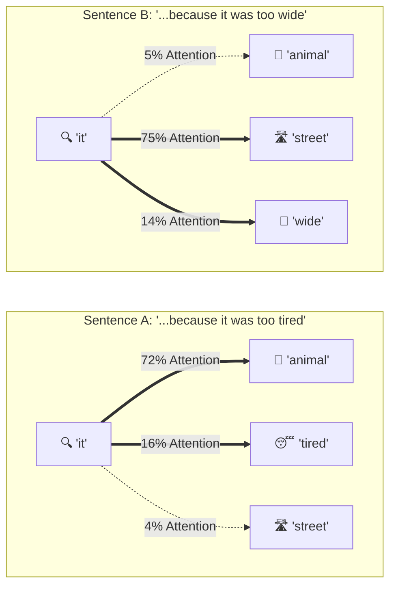
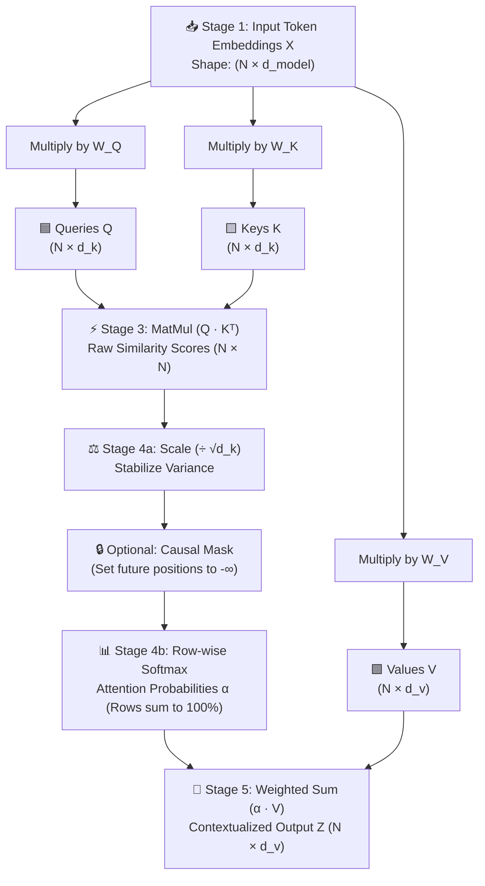

# 🎯 Topic #1: Self-Attention (Queries, Keys, Values & Scaled Dot-Product Attention)

> **[🌐 Launch Interactive Visual Explorer (GitHub Pages)](./index.html)** | **[⬅️ Back to Main Repository](../../README.md)**

---

## 🧭 Quick Overview: The 5-Step Learning Framework

| Step | Focus | Key Question Answered |
| :--- | :--- | :--- |
| **Step 1** | **Big Picture & Intuition** | *Why do words need to "look at" each other across a sentence?* |
| **Step 2** | **5-Stage Visual Pipeline** | *How do raw word embeddings flow through $Q$, $K$, $V$ into context-aware vectors?* |
| **Step 3** | **Worked Toy Matrix Example** | *What happens to every single number when we compute attention by hand?* |
| **Step 4** | **Why Scale by $\sqrt{d_k}$?** | *Why does dividing by $\sqrt{d_k}$ rescue gradients from vanishing inside Softmax?* |
| **Step 5** | **PyTorch Code & Flashcards** | *How does the entire equation translate into 15 lines of clean PyTorch?* |

---

## 💡 Step 1: The Big Picture & Intuition

### The Core Problem: Static Word Embeddings Are Context-Blind
In older models (like Word2Vec), the word **"it"** or **"bank"** always had the exact same static vector, no matter what words surrounded it. Consider these two classic Winograd schema sentences:

* **Sentence A:** *"The **animal** didn't cross the street because **it** was too **tired**."*  
  👉 Here, **"it"** refers to **"animal"** (because animals get *tired*).
* **Sentence B:** *"The animal didn't cross the **street** because **it** was too **wide**."*  
  👉 Here, **"it"** refers to **"street"** (because streets are *wide*).



**Self-Attention** solves this by allowing every token in a sequence to **dynamically look at every other token**, measure how relevant they are to each other, and absorb a weighted blend of their meanings!

---

### 📚 The Search Engine / Library Analogy ($Q$, $K$, $V$)

Instead of comparing raw word vectors directly ($X \cdot X^T$), Self-Attention projects each word embedding $x_i$ into **three distinct roles** using learned weight matrices ($W_Q, W_K, W_V$):

| Vector | Color Code | Analogy Role | Intuitive Question | Mathematical Projection |
| :--- | :--- | :--- | :--- | :--- |
| **Query ($Q$)** | 🟦 **Cyan** (`#38bdf8`) | **Search Query** typed into Google / library catalog | *"What kind of information am I looking for?"* | $Q = X W_Q$ |
| **Key ($K$)** | 🟨 **Amber** (`#fbbf24`) | **Book Title / Tags** on the spine of every book | *"What kind of information do I contain or advertise?"* | $K = X W_K$ |
| **Value ($V$)** | 🟩 **Emerald** (`#34d399`) | **Book Contents** inside the book once opened | *"What actual semantic payload do I pass along if selected?"* | $V = X W_V$ |

> [!TIP]
> **Why not just use $X \cdot X^T$ without $Q, K, V$?**  
> If we multiplied $X \cdot X^T$ directly, the similarity matrix would be forced to be **symmetric** (Word A would have to attend to Word B with the exact same strength that Word B attends to Word A), and a word would always attend most strongly to itself! Separate $Q$ and $K$ projections make attention **asymmetric and role-specific** (e.g., the pronoun *"it"* issues a Query looking for a noun Key *"animal"*).

---

## 🔄 Step 2: The 5-Stage Visual Pipeline ("Watch Tensors Flow")

Here is the complete architecture of **Scaled Dot-Product Attention**:

$$\text{Attention}(Q, K, V) = \underbrace{\text{softmax}\!\left(\frac{\overbrace{Q K^T}^{\text{Stage 3: Similarity}}}{\underbrace{\sqrt{d_k}}_{\text{Stage 4: Scale}}}\right)}_{\text{Stage 4: Attention Weights } (\alpha)} \cdot \overbrace{V}^{\text{Stage 5: Blend Values}}$$



### Summary of the 5 Stages

1. **Stage 1 — Token Embeddings ($X$):** Convert each of the $N$ words into a dense vector of size $d_{\text{model}}$.
2. **Stage 2 — Linear Projections ($Q, K, V$):** Multiply $X$ by three learned weight matrices $W_Q, W_K, W_V$ to create Query, Key, and Value representations for every token.
3. **Stage 3 — Similarity Scores ($S = Q K^T$):** Take the dot product between every word's Query vector and every word's Key vector. High dot product = high alignment. This produces an $N \times N$ score matrix.
4. **Stage 4 — Scale ($\div \sqrt{d_k}$) & Softmax:** Divide raw scores by $\sqrt{d_k}$ so large dimensions don't blow up the variance, then apply row-wise Softmax so every row becomes a clean probability distribution summing to `1.0` (`100%`).
5. **Stage 5 — Weighted Sum of Values ($Z = \alpha V$):** Multiply each token's attention weights by the Value vectors $V$. Each word becomes a context-enriched blend of the words it attended to!

---

## 🧮 Step 3: Complete Worked Numerical Example ($3 \times 2$ Toy Matrices)

Let's trace the exact arithmetic by hand on a tiny **3-word sentence**: `["Dream", "big", "now"]` ($N = 3$) with $2\text{D}$ vectors ($d_k = d_v = 2$).

### Stage 1 & 2: Toy $Q$, $K$, and $V$ Vectors

Suppose after projecting our 3 words through $W_Q, W_K, W_V$, we have the following $3 \times 2$ matrices:

| Token | 🟦 Query $q_i$ (`[q₁, q₂]`) | 🟨 Key $k_i$ (`[k₁, k₂]`) | 🟩 Value $v_i$ (`[v₁, v₂]`) | Semantic Role in Example |
| :--- | :---: | :---: | :---: | :--- |
| **1. `"Dream"`** | `[1.0, 0.0]` | `[1.0, 0.2]` | `[2.0, 0.0]` | Core action verb looking for modifiers |
| **2. `"big"`** | `[0.8, 0.6]` | `[0.8, 0.6]` | `[0.0, 3.0]` | Intensity modifier strongly aligned with `"Dream"` |
| **3. `"now"`** | `[0.0, 1.0]` | `[0.2, 1.0]` | `[1.0, 1.0]` | Temporal marker aligned with the second dimension |

---

### Stage 3: Compute Raw Similarity Scores ($S = Q K^T$)

Recall the dot product of two 2D vectors: $q \cdot k = q_1 k_1 + q_2 k_2$.
Let's compute **Row 1** (how `"Dream"`'s Query $q_{\text{Dream}} = [1.0, 0.0]$ scores against all three Keys):

* $q_{\text{Dream}} \cdot k_{\text{Dream}} = (1.0)(1.0) + (0.0)(0.2) = \mathbf{1.00}$
* $q_{\text{Dream}} \cdot k_{\text{big}} = (1.0)(0.8) + (0.0)(0.6) = \mathbf{0.80}$
* $q_{\text{Dream}} \cdot k_{\text{now}} = (1.0)(0.2) + (0.0)(1.0) = \mathbf{0.20}$

Doing this for all 3 rows gives the $3 \times 3$ **Raw Score Matrix $S = Q K^T$**:

| Query $\downarrow$ \ Key $\rightarrow$ | `"Dream"` $k_1 = [1.0, 0.2]$ | `"big"` $k_2 = [0.8, 0.6]$ | `"now"` $k_3 = [0.2, 1.0]$ |
| :--- | :---: | :---: | :---: |
| **`"Dream"`** $q_1 = [1.0, 0.0]$ | `1.00` | `0.80` | `0.20` |
| **`"big"`** $q_2 = [0.8, 0.6]$ | `0.92` | `1.00` | `0.76` |
| **`"now"`** $q_3 = [0.0, 1.0]$ | `0.20` | `0.60` | `1.00` |

---

### Stage 4a: Scale by $\sqrt{d_k} = \sqrt{2} \approx 1.414$

We divide every entry in $S$ by $\sqrt{2} \approx 1.4142$:

| Query $\downarrow$ \ Key $\rightarrow$ | `"Dream"` ($\div \sqrt{2}$) | `"big"` ($\div \sqrt{2}$) | `"now"` ($\div \sqrt{2}$) |
| :--- | :---: | :---: | :---: |
| **`"Dream"`** | $1.00 / 1.414 = \mathbf{0.71}$ | $0.80 / 1.414 = \mathbf{0.57}$ | $0.20 / 1.414 = \mathbf{0.14}$ |
| **`"big"`** | $0.92 / 1.414 = \mathbf{0.65}$ | $1.00 / 1.414 = \mathbf{0.71}$ | $0.76 / 1.414 = \mathbf{0.54}$ |
| **`"now"`** | $0.20 / 1.414 = \mathbf{0.14}$ | $0.60 / 1.414 = \mathbf{0.42}$ | $1.00 / 1.414 = \mathbf{0.71}$ |

---

### Stage 4b: Row-Wise Softmax ($\alpha = \text{softmax}(S / \sqrt{d_k})$)

For **Row 1 (`"Dream"`)**, we exponentiate each scaled score and divide by the row sum:
* $e^{0.71} \approx 2.034$, $\quad e^{0.57} \approx 1.768$, $\quad e^{0.14} \approx 1.150$
* $\text{Row Sum} = 2.034 + 1.768 + 1.150 = 4.952$
* $\alpha_{1,1} = 2.034 / 4.952 = \mathbf{0.41}$ (`41%`)
* $\alpha_{1,2} = 1.768 / 4.952 = \mathbf{0.36}$ (`36%`)
* $\alpha_{1,3} = 1.150 / 4.952 = \mathbf{0.23}$ (`23%`)

| Query $\downarrow$ \ Attended Token $\rightarrow$ | `"Dream"` ($\alpha_{i,1}$) | `"big"` ($\alpha_{i,2}$) | `"now"` ($\alpha_{i,3}$) | Row Total |
| :--- | :---: | :---: | :---: | :---: |
| **`"Dream"`** | **41%** (`0.41`) | **36%** (`0.36`) | **23%** (`0.23`) | `100%` (`1.00`) |
| **`"big"`** | **33%** (`0.33`) | **36%** (`0.36`) | **31%** (`0.31`) | `100%` (`1.00`) |
| **`"now"`** | **24%** (`0.24`) | **33%** (`0.33`) | **43%** (`0.43`) | `100%` (`1.00`) |

---

### Stage 5: Weighted Sum of Values ($Z = \alpha V$)

Finally, each word's new context-aware representation $z_i$ is the weighted sum of all Value vectors $v_1 = [2.0, 0.0]$, $v_2 = [0.0, 3.0]$, $v_3 = [1.0, 1.0]$:

For **`"Dream"` ($z_1$)**:
$$z_{\text{Dream}} = 0.41 \cdot \begin{bmatrix} 2.0 \\ 0.0 \end{bmatrix} + 0.36 \cdot \begin{bmatrix} 0.0 \\ 3.0 \end{bmatrix} + 0.23 \cdot \begin{bmatrix} 1.0 \\ 1.0 \end{bmatrix} = \begin{bmatrix} 0.82 \\ 0.00 \end{bmatrix} + \begin{bmatrix} 0.00 \\ 1.08 \end{bmatrix} + \begin{bmatrix} 0.23 \\ 0.23 \end{bmatrix} = \mathbf{\begin{bmatrix} 1.05 \\ 1.31 \end{bmatrix}}$$

| Token | Original Value $v_i$ | Attention Mix ($\alpha_{i,1} v_1 + \alpha_{i,2} v_2 + \alpha_{i,3} v_3$) | Contextualized Output $z_i$ | What Changed? |
| :--- | :---: | :--- | :---: | :--- |
| **`"Dream"`** | `[2.00, 0.00]` | $0.41 v_1 + 0.36 v_2 + 0.23 v_3$ | **`[1.05, 1.31]`** | Absorbed intensity (`1.31` in dim 2) from `"big"` & `"now"`! |
| **`"big"`** | `[0.00, 3.00]` | $0.33 v_1 + 0.36 v_2 + 0.31 v_3$ | **`[0.97, 1.39]`** | Balanced context across all three words in the phrase. |
| **`"now"`** | `[1.00, 1.00]` | $0.24 v_1 + 0.33 v_2 + 0.43 v_3$ | **`[0.91, 1.42]`** | Grounded its temporal meaning with `"big"` and `"Dream"`. |

---

## ⚖️ Step 4: Why Scale by $\sqrt{d_k}$? (Visualized)

Suppose the embedding dimension per head is $d_k = 64$ (standard in Transformers).
If the components of $q$ and $k$ are independent random variables with mean $0$ and variance $1$, then their dot product $q \cdot k = \sum_{i=1}^{d_k} q_i k_i$ has:
* **Mean:** $0$
* **Variance:** $d_k = 64$ (so standard deviation is $\sqrt{64} = 8$!)

Without scaling, raw dot products easily reach values like `10` and `20`. Watch what happens to Softmax and its gradients when we don't divide by $\sqrt{64} = 8$:

| Scenario | Input Logits to Softmax | Softmax Probabilities | Softmax Jacobian / Gradient $\alpha_1(1-\alpha_1)$ | Training Impact |
| :--- | :---: | :---: | :---: | :--- |
| ❌ **Unscaled** ($\div 1$) | `[10.0, 20.0]` | `[0.000045, 0.999955]` | **`0.000045`** (Near Zero!) | **Vanishing Gradient!** Model gets stuck in a hard argmax and stops learning. |
| ✅ **Scaled** ($\div \sqrt{64} = 8$) | `[1.25, 2.50]` | `[0.2227, 0.7773]` | **`0.1731`** (Healthy!) | **Smooth Gradient Flow!** Both tokens receive meaningful updates during backprop. |

> [!IMPORTANT]
> **Key Takeaway on $\div \sqrt{d_k}$:**  
> Dividing by $\sqrt{d_k}$ forces the dot product $q \cdot k / \sqrt{d_k}$ back to **unit variance ($\text{Var} = 1$)** regardless of how large $d_k$ is, keeping Softmax in its responsive, high-gradient region!

---

## 💻 Step 5: Minimal PyTorch Implementation & Summary

Here is a clean, production-grade PyTorch implementation of `scaled_dot_product_attention` where every line directly maps to Stages 1–5:

```python
import math
import torch
import torch.nn.functional as F

def scaled_dot_product_attention(
    Q: torch.Tensor,  # Shape: (batch, heads, seq_len, d_k)
    K: torch.Tensor,  # Shape: (batch, heads, seq_len, d_k)
    V: torch.Tensor,  # Shape: (batch, heads, seq_len, d_v)
    mask: torch.Tensor | None = None
) -> tuple[torch.Tensor, torch.Tensor]:
    """
    Computes Scaled Dot-Product Attention: Attention(Q, K, V) = softmax(QK^T / sqrt(d_k)) V
    """
    # Stage 3: Raw Similarity Scores (Q · K^T) -> Shape: (batch, heads, seq_len, seq_len)
    d_k = Q.size(-1)
    scores = torch.matmul(Q, K.transpose(-2, -1))

    # Stage 4a: Scale by sqrt(d_k) to preserve unit variance
    scaled_scores = scores / math.sqrt(d_k)

    # Optional Causal / Padding Mask: set masked positions to -infinity before Softmax
    if mask is not None:
        scaled_scores = scaled_scores.masked_fill(mask == 0, float("-inf"))

    # Stage 4b: Row-wise Softmax -> Attention probabilities summing to 1.0 along last dim
    attn_weights = F.softmax(scaled_scores, dim=-1)

    # Stage 5: Weighted Sum of Values (Weights · V) -> Shape: (batch, heads, seq_len, d_v)
    output = torch.matmul(attn_weights, V)
    return output, attn_weights
```

---

### 🧠 Self-Check Summary & Key Takeaways

| Question | Crystal-Clear Answer |
| :--- | :--- |
| **1. Why separate $Q, K, V$ instead of $X X^T$?** | Separate learned projections allow **asymmetric relationships** (a pronoun looking for a noun) and decouple *how words match* ($Q, K$) from *what information gets passed* ($V$). |
| **2. Why divide by $\sqrt{d_k}$?** | Dot products of $d_k$-dimensional vectors have variance $d_k$. Dividing by $\sqrt{d_k}$ restores variance to $1$, preventing Softmax saturation and vanishing gradients. |
| **3. What is the complexity of Self-Attention?** | Because every token attends to every other token, the attention matrix has shape $N \times N$, giving **$O(N^2 \cdot d_k)$ time and $O(N^2)$ memory complexity** with sequence length $N$. |
| **4. How does Causal Masking (in GPT) work?** | Before Softmax (in Stage 4), upper-triangular entries $(i < j)$ are set to $-\infty$. Since $e^{-\infty} = 0$, token $i$ assigns **0% attention** to future tokens $j > i$. |
| **5. Why Multi-Head Attention?** | Running $h$ independent $(Q_i, K_i, V_i)$ heads in parallel lets different heads specialize simultaneously (e.g., Head 1 tracks pronoun coreference, Head 2 tracks verb-object grammar, Head 3 tracks semantic proximity). |

---

> **[🌐 Open the Interactive Visual Page (`topics/self-attention/index.html`)](./index.html)** to experiment with the live SVG Sentence Attention Explorer, the 5-Stage Tensor Stepper, and the Interactive Query-Key-Value Sandbox!
